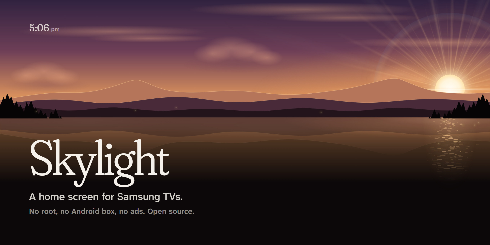
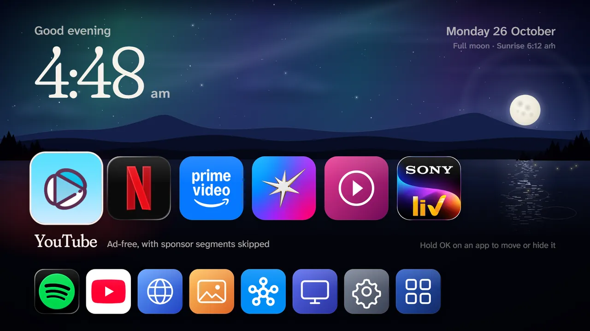
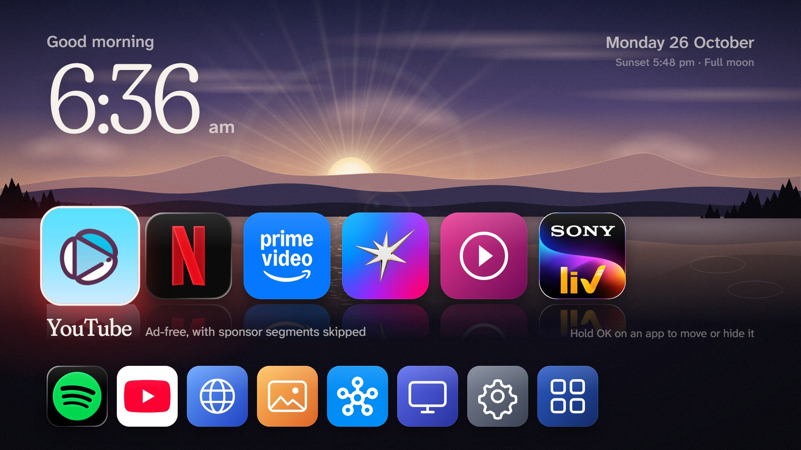
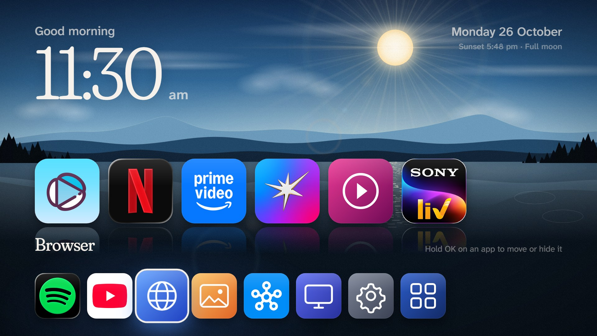
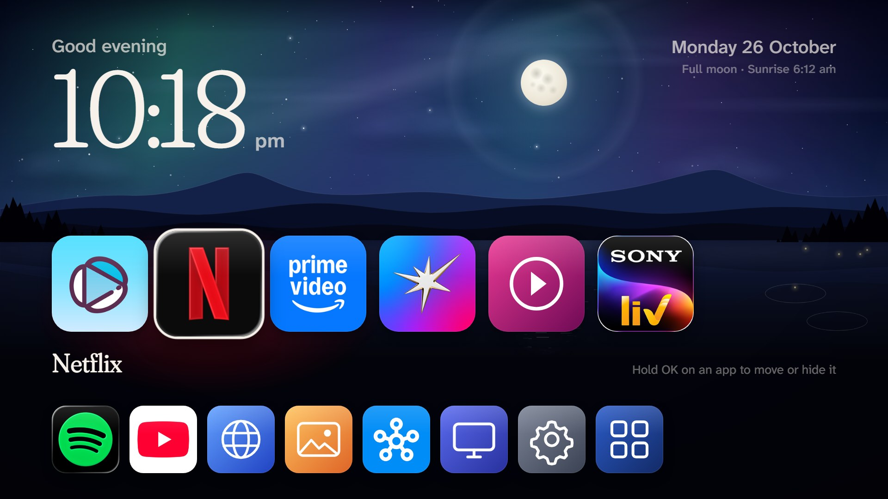
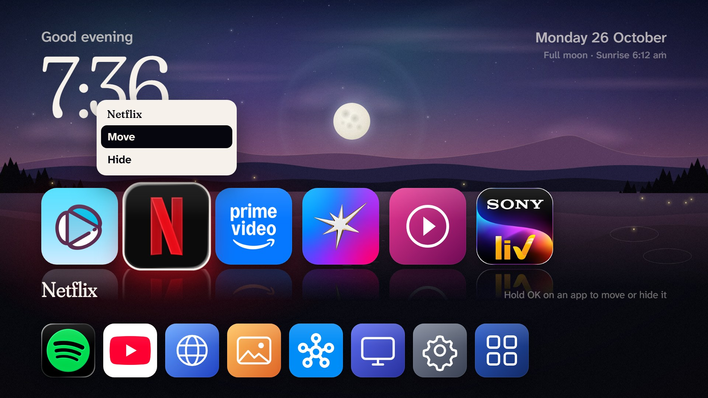
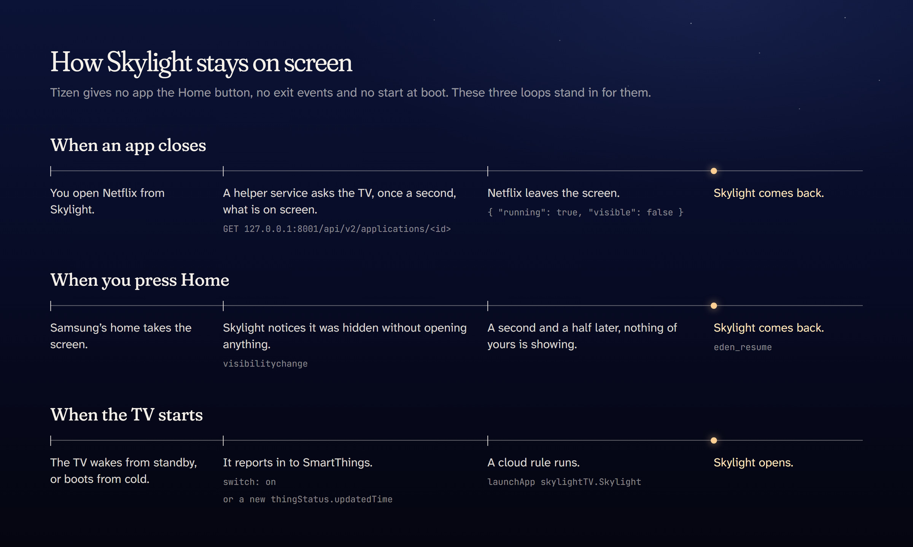

<p align="center">
  
</p>

<p align="center">
  <a href="https://saudsatopay.github.io/skylight-tizen/"></a>
  <a href="https://github.com/SaudSatopay/skylight-tizen/releases/latest"></a>
  <a href="LICENSE"></a>
  
  
</p>

**Skylight replaces what you see when you turn on a Samsung TV.** Your apps as tiles, under a sky that
follows the hour, and nothing sponsored. It is a sideloaded Tizen web app: no root, no Android box, nothing
removed from the TV. Three small loops keep it in place on a system that was never meant to allow a
third-party home screen: it comes back when an app closes, it answers the Home button, and it starts with
the TV.

<p align="center">
  
  <br><sub>A whole day in nine seconds, drawn by the same code the TV runs.</sub>
</p>

## Why this exists

In October 2026 [Clean Your TV](https://github.com/Gathin23/cleanyourtv) went viral: 38,000 GitHub stars in
nine days, and a showcase of more than a hundred projects built around it. It works because Android TVs
have ADB. Turn on debugging, switch the manufacturer's bloat off with `pm disable-user`, install a clean
launcher and make it Home.

Samsung TVs run Tizen, and none of that exists there. Clean Your TV's own
[notes on Tizen](https://github.com/Gathin23/cleanyourtv/blob/main/docs/devices/samsung-tizen.md) put it
plainly: there is no shell to switch Samsung's apps off, and a custom app tested on a 2024 Samsung still lost
the Home button to Samsung Home and came back on HDMI after a restart.

Skylight takes a different route. It leaves Samsung's software where it is, puts a better home screen in
front of it, and then does the work Tizen won't do for it: noticing when it has lost the screen, and taking
it back.

| | Android TV with Clean Your TV | Samsung TV as it ships | Samsung TV with Skylight |
|---|---|---|---|
| Sponsored rows on the home screen | Switched off over ADB | Always there | Out of sight: Skylight is the home you see |
| Your own home screen | Replaces the launcher | Not possible | A sideloaded app that holds its place |
| Press Home | The new launcher | Samsung Home | Skylight, a moment later |
| Leave an app | The new launcher | Samsung Home | Skylight |
| Turn the TV on | The new launcher | Samsung Home or the last source | Skylight (about 90 s after a cold boot) |
| What it changes on the TV | Disables apps, restorably | Nothing | Nothing |

## What it does

- **Your apps as tiles.** Favourites on top, the rest below. Hold **OK** on a tile to move it or hide it.
  New apps show up by themselves; Samsung's system apps don't.
- **Comes back when an app closes.** Exit Netflix, YouTube or anything else and you land on Skylight, even
  with apps the TV keeps running in the background.
- **Answers the Home button.** Press Home anywhere and Skylight is back a moment later. A Samsung tile hands
  you Samsung's own screen for three minutes when you need the app store.
- **Starts with the TV**, from standby and from a cold boot, through two small SmartThings cloud rules.
- **A sky that keeps the time.** Dawn, day, golden hour, dusk and night blend into each other, the sun and
  moon cross the sky, the moon shows its real phase, and the line under the date gives the next sunrise or
  sunset.
- **Fast on TV hardware.** On the TV the scenery is painted once a minute into one flat image, and only a few
  tiny things move. No frameworks, no network calls, fonts bundled: the whole app is about half a megabyte.
- **Ad-free YouTube** with [TizenTube](https://github.com/reisxd/TizenTube), which Skylight shows as YouTube
  and returns from cleanly.

<table>
  <tr>
    <td width="50%"></td>
    <td width="50%"></td>
  </tr>
  <tr>
    <td></td>
    <td></td>
  </tr>
</table>

## Try it in your browser

The [live demo](https://saudsatopay.github.io/skylight-tizen/) is the real app, with a stand-in for the TV.
Use the arrow keys and Enter, and hold Enter on a tile for Move and Hide. Jump to
[dawn](https://saudsatopay.github.io/skylight-tizen/?hour=6.6),
[noon](https://saudsatopay.github.io/skylight-tizen/?hour=12.5),
[golden hour](https://saudsatopay.github.io/skylight-tizen/?hour=17.1),
[dusk](https://saudsatopay.github.io/skylight-tizen/?hour=19.4) or
[night](https://saudsatopay.github.io/skylight-tizen/?hour=22.4).
App logos are not part of this repository, so the demo shows lettered tiles in their place.

## How it works

<p align="center">
  
</p>

Samsung's platform forbids most of what a launcher needs, so Skylight is three parts, each covering
something the others can't.

**The app** (`skylight/`) is a plain Tizen web app: one HTML page, hand-written CSS and JavaScript, no build
step beyond zipping. It opens apps with `tizen.application.launch` and keeps running in the background.
When it loses the screen without having opened anything, that was the Home button: it waits a second and a
half, checks that no app of yours took over, and brings itself back with Samsung's own `eden_resume` app
control, so it returns instantly instead of reloading.

**The helper** (`skylight/service/index.js`) is a Tizen web service: Node.js, started by the app, living on
as its own process so it keeps watching even while the TV freezes the page under a heavy app. It asks the
TV's own status service whether the app you opened is still on screen:

```
GET http://127.0.0.1:8001/api/v2/applications/<app id>
{ "running": true, "visible": false }
```

That service answers without a token only to callers on the TV itself. Exiting YouTube, for instance, never
closes it, it only leaves the screen, so *leaving the screen* is the signal, and Skylight comes back. The
helper also serves its log on `127.0.0.1:8130`, which the diagnostics panel shows (select a top-row tile and
press **Up** three times).

**The cloud rules** (`tools/smartthings-skylight.ps1`) handle startup, which nothing on the TV can do: it
ignores `on-boot` for sideloaded services, and this model has no "autorun last app". Samsung TVs expose
`launchApp` and `remoteControl.send` to the SmartThings API (the SmartThings phone app's routine editor
hides them), and SmartThings Rules run on Samsung's servers with no device of yours left on. One rule fires
when the TV reports it has woken from standby. A cold boot sends no power event at all, but the TV does
refresh a status timestamp when it checks in, and the second rule listens for that.

<details>
<summary><b>What does not work on these TVs</b>, so you don't have to try it</summary>
<br>

| Idea | What happens |
|---|---|
| Catching the Home key | Samsung keeps it; no app receives it. |
| Registering as a source | Not available to third-party apps. |
| Replacing the home app id | Possible on some sets by rewriting system settings over the developer connection, as [CleanFrame](https://github.com/nthnclrk/CleanFrame) does. Skylight leaves it alone: it is undocumented, differs by model and firmware, and changes the TV itself. |
| `on-boot="true"` services | Ignored for sideloaded apps; nothing runs until something launches it. |
| `prelaunch.support` | Not supported since 2019 TVs. |
| `getAppsContext()` as an "app closed" signal | Resident apps such as YouTube stay in the list after you exit them. |
| The casting (DIAL) service from the TV itself | Answers 401 to callers on the TV. |
| Launching YouTube in the caller's app group | It hands over to Samsung's resident YouTube engine instead. |
| The SmartThings phone app's routines | They don't offer "open app"; the API does. |

The full investigation, dead ends included, is in [docs/startup-investigation.md](docs/startup-investigation.md).
</details>

## Install

**You need** a Samsung TV with Developer Mode (tested on a 2025 model with Tizen 9; see
[compatibility](#compatibility)), a Windows PC on the same network for the PowerShell scripts, and a Samsung
account. The startup rules also need the TV added to SmartThings.

**1. Developer Mode on the TV.** Open the Apps screen and type `1 2 3 4 5` on the remote. On remotes without
number keys, the SmartThings phone app's remote has a keypad. Switch Developer Mode on, enter your PC's IP
address as the Host PC IP, then unplug the TV for a full minute and plug it back in. On 2025 models a normal
restart isn't enough.

**2. The installer.** Download `Apps2Samsung-cli-<version>-win-x64.zip` from the
[Apps2Samsung releases](https://github.com/Apps2Samsung/Apps2Samsung/releases), unzip it, and check that it
finds the TV:

```powershell
apps2samsung-cli scan
```

**3. The app.** Download `Skylight.wgt` from the [latest release](https://github.com/SaudSatopay/skylight-tizen/releases/latest),
or build it yourself with the app logos, which aren't redistributed here:

```powershell
tools\fetch-icons.ps1        # downloads the logos into skylight\icons
tools\build-skylight.ps1     # writes dist\Skylight.wgt
```

**4. Install it.** The first install opens a browser so you can sign in to Samsung, which creates a signing
certificate for your TV. Later installs reuse it.

```powershell
apps2samsung-cli install dist\Skylight.wgt --tv <TV IP> --partner --launch
```

Add `--local-ip <PC IP>` if the PC has more than one network. For ad-free YouTube, install TizenTube from the
installer's catalog the same way: `apps2samsung-cli install TizenTube --tv <TV IP>`.

**5. TV settings.** Settings, All Settings, Advanced Features, Start Screen Options: turn *Start with Smart
Hub Home* **on**, so a cold boot waits on Samsung's home rather than a "no signal" screen while startup runs,
and turn *Autorun Samsung TV Plus* **off**.

**6. Startup.** Create a token at <https://account.smartthings.com/tokens> with *Devices: read, execute*,
*Locations: read* and *Rules: read, write, execute*. New tokens expire after 24 hours, which is fine: the
rules keep running without it.

```powershell
$env:SMARTTHINGS_TOKEN = '<token>'
tools\smartthings-skylight.ps1                                      # finds the TV, checks it accepts app launches
tools\smartthings-skylight.ps1 -Test                                # opens Skylight on the TV through the cloud
tools\smartthings-skylight.ps1 -CreateRule                          # standby wake: Skylight
tools\smartthings-skylight.ps1 -ReportRule -BootDelay 5 -NoHomeKey  # cold boot: Skylight
```

If your TV starts on a tuner "no signal" screen instead of Samsung's home, leave out `-NoHomeKey` and the rule
presses Home before launching. `-ListRules`, `-DeleteRule poweron` or `-DeleteRule checkin`, `-Status`,
`-History`, `-Execute checkin` and `-Capability <name>` are there for looking around.

## Everyday use

| Do this | Get this |
|---|---|
| Arrows, then OK | Move around, open an app |
| Hold OK on a tile | Move it with the arrows, or hide it |
| The Hidden apps tile, at the end of the bottom row | Bring hidden apps back |
| The Samsung tile, then Home | Samsung's own screen for three minutes, for the app store |
| Home, from anywhere | Skylight |
| Back out of any app | Skylight |
| A top-row tile, then Up three times | Diagnostics: what Skylight and its helper noticed |

## Make it yours

Everything opinionated lives in two files.

- **`skylight/js/catalog.js`** decides which apps are favourites, the order of the rest, which apps stay
  hidden, and each app's name, logo, colour and the note shown when it is selected. Store apps that aren't
  listed still appear, with a colour of their own; Samsung's system apps are skipped unless listed.
- **`skylight/js/scenery.js`** holds the five skies (`SKIES`), how long they take to blend, and sunrise and
  sunset (`SUNRISE`, `SUNSET`, in hours).

To preview on a PC, serve the `skylight` folder with any static server and open it in a browser; a stand-in
replaces the TV's `tizen` API. Handy flags: `?hour=22.4` for any time of day, `?lean` for the TV's rendering,
`?still` for screenshots, `?visitors` for birds and shooting stars right away, and `?keys=39,39,13` to replay
remote keys.

## Compatibility

| TV | Year | Tizen | Result |
|---|---|---|---|
| Samsung Crystal UHD UA43UE86AFULXL | 2025 | 9.0 | Everything works. A cold boot reaches Skylight after about 90 seconds. |
| Samsung The Frame QA75LS03BASXNZ | 2022 | 6.5 | Tested with another launcher that makes the same status calls, not with Skylight itself ([#1](https://github.com/SaudSatopay/skylight-tizen/issues/1)). Coming back after Home and after ordinary web apps works. Returning from Netflix, Disney+, Prime Video and YouTube doesn't: the TV reports them as off screen even while they play. |

Tried it on another Samsung? [Tell us how it went](https://github.com/SaudSatopay/skylight-tizen/issues/new?template=compatibility.yml),
good or bad. This table grows from those reports.

## Questions

<details>
<summary><b>Does it change anything on the TV's system?</b></summary>
<br>
No. It is an ordinary app installed through Samsung's own Developer Mode, the way developers test their apps.
Nothing is rooted, flashed, patched or disabled. Uninstall it from the Apps screen and the TV is exactly as it
was. The startup rules live in your SmartThings account; <code>-DeleteRule poweron</code> and
<code>-DeleteRule checkin</code> remove them.
</details>

<details>
<summary><b>Are Samsung's ads gone?</b></summary>
<br>
From the screen you see, yes. Samsung's home still exists underneath, and you'll see it for a moment after
pressing Home, or whenever you open it on purpose through the Samsung tile. Turning off <i>Autorun Samsung TV
Plus</i> and the ad and viewing-information options under Settings, Privacy Choices removes most of the rest.
</details>

<details>
<summary><b>Does my PC have to stay on?</b></summary>
<br>
No. The PC is only for installing. The helper runs on the TV, and the startup rules run in Samsung's cloud.
</details>

<details>
<summary><b>Why does a cold boot take about 90 seconds?</b></summary>
<br>
After the power has been off, the TV needs about that long to get back online and report in to SmartThings,
and nothing on the TV may start a sideloaded app before then. Waking from standby is much quicker. If you
always turn the TV off with the remote, you rarely see a cold boot at all.
</details>

<details>
<summary><b>What happens after a firmware update?</b></summary>
<br>
Installed apps stay. If Samsung ever changes the TV's local status service, returning from apps could stop
working; the diagnostics panel will show it, and an issue here will get it looked at.
</details>

<details>
<summary><b>Why not just buy an Android TV box?</b></summary>
<br>
You can, and Clean Your TV is excellent there. Skylight is for keeping the TV you already have, with its own
remote, picture settings and apps, and making it calm.
</details>

<details>
<summary><b>Does it collect anything?</b></summary>
<br>
No. No analytics, no accounts, no network calls. The helper talks only to the TV itself on 127.0.0.1, and the
startup rules sit in your own SmartThings account.
</details>

<details>
<summary><b>Does it work on Android TV or LG?</b></summary>
<br>
No, Skylight is for Samsung's Tizen. For Android TV and Google TV, use
<a href="https://github.com/Gathin23/cleanyourtv">Clean Your TV</a> or its
<a href="https://github.com/udhaykumarbala/cleanyourtv-app">phone app</a>; its showcase also lists projects
for Fire TV and LG webOS.
</details>

## Performance notes

The TV's graphics chip is the limit, not the code. What proved expensive on a budget chip: many large
translucent layers blended every frame, such as CSS masks, `-webkit-box-reflect`, drifting full-screen
gradients and gliding transforms. What proved free: anything drawn once and left alone, plus a few small
transform and opacity animations. Skylight switches to a lean rendering on the TV (the class `lean` on
`#screen`) and keeps the richer one for the browser. If you add an effect, keep it small, or keep it behind
`.screen:not(.lean)`.

## Known limits

- A cold boot shows Samsung's home for about 90 seconds before Skylight appears (see above).
- The cold-boot rule relies on Skylight having been the last app on screen when the power went. After a cut
  while another app was showing, one press of Home brings Skylight back.
- Sideloaded apps need Developer Mode to stay on, with the Host PC IP pointing at a machine that exists.
- Skylight comes back only after apps that report themselves as on screen. On 2022 sets (Tizen 6.5),
  Samsung's integrated apps such as Netflix, Disney+, Prime Video and YouTube don't
  ([#1](https://github.com/SaudSatopay/skylight-tizen/issues/1)); after those, open Skylight from Samsung's
  apps row.

## Contributing

Reports from other TVs are the most useful thing right now; there's a form for them. Code is welcome too:
see [CONTRIBUTING.md](CONTRIBUTING.md) for how to preview, what to keep in mind for TV hardware, and how to
test on a set.

## Credits

- [Clean Your TV](https://github.com/Gathin23/cleanyourtv) by Gathin, for starting the wave, and for writing
  down honestly what does and doesn't work on Tizen.
- [TizenTube](https://github.com/reisxd/TizenTube) and [TizenBrew](https://github.com/reisxd/TizenBrew) by
  reisxd, for ad-free YouTube on Tizen.
- [Apps2Samsung](https://github.com/Apps2Samsung/Apps2Samsung), which turns installs and certificates into
  one command.
- Fonts: [Fraunces](https://github.com/undercasetype/Fraunces) by Undercase Type and
  [Atkinson Hyperlegible Next](https://github.com/googlefonts/atkinson-hyperlegible-next) by the Braille
  Institute, both under the SIL Open Font License.

## License

MIT, see [LICENSE](LICENSE). The bundled fonts keep their own licenses, and app logos belong to their owners.
