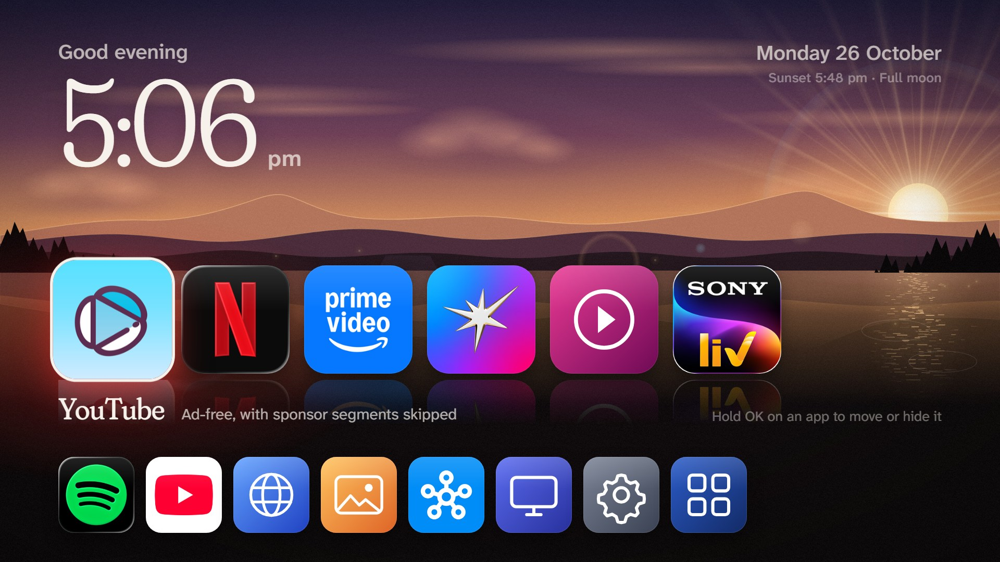

<h1 align="center">Skylight</h1>

<p align="center">
  A fast, ad-free home screen for Samsung Tizen TVs.<br>
  No root, no Android box, no firmware mods: a sideloaded web app that takes over the Home button,
  comes back when apps close, and starts with the TV.
</p>

<p align="center">
  <a href="LICENSE"></a>
  
  
  
</p>

<p align="center">
  
</p>

## Why

Samsung's home screen on a new TV is a billboard: sponsored rows, a channel app that autoruns at power-on,
"recommendations", and a launcher that takes its time. The usual answer is to plug in an Android box and
re-skin that. Skylight takes the other road: it keeps the TV exactly as it is and replaces only what you look
at. Your apps, your order, a sky that follows the time of day, nothing else.

It was built for a 2025 Crystal UHD (UA43UE86AFULXL, Tizen 9) over one long day of trying things on the real
hardware. Everything below is what survived.

<table>
  <tr>
    <td></td>
    <td></td>
  </tr>
  <tr>
    <td></td>
    <td></td>
  </tr>
</table>

## What it does

- **Shows your apps as logo tiles**, two rows: favourites on top, everything else below. Hold **OK** on a
  tile to move it (left/right, or up/down between rows) or hide it. Apps installed later appear by themselves;
  Samsung's system apps don't.
- **Comes back when an app closes.** Exit Netflix, YouTube or anything else and you land on Skylight, not on
  Samsung's home. This works even for apps the TV keeps resident, such as YouTube.
- **Takes over the Home button.** Press Home anywhere and Skylight returns a moment later. A "Samsung" tile
  gives you Samsung's own screen back for three minutes whenever you need the app store.
- **Starts with the TV**, both from standby and from a cold boot, through two small SmartThings cloud rules
  (the TV refuses to start sideloaded apps itself; see [how it works](#how-it-works)).
- **Paints the sky for the hour**: dawn, day, golden hour, dusk and night blend into each other, with the sun
  and its glare, the moon in its real phase, stars, aurora, mist, pines and a lake that mirrors it all. The
  line under the date tells you the moon phase and the next sunrise or sunset.
- **Stays fast on TV hardware.** On the TV the scenery is painted once a minute into a single flat image;
  only a handful of tiny things animate. The full version with drifting clouds, breathing light and gliding
  sun runs in the desktop preview. No frameworks, no network calls, fonts bundled.
- **Ad-free YouTube** by pairing with [TizenTube](https://github.com/reisxd/TizenTube), which Skylight
  shows as "YouTube" and returns from cleanly.

## How it works

Samsung's platform forbids most of what a launcher needs, so Skylight is three parts that each cover one
thing the others can't.

```
 ┌──────────────────────────┐   launches apps     ┌──────────────────────────────┐
 │  Skylight (web app)      │ ───────────────────▶│  Netflix, TizenTube, ...     │
 │  the screen you see      │                     └──────────────────────────────┘
 │  - notices when it loses │                                    │ "is it still on screen?"
 │    the screen (Home)     │                                    ▼
 │  - asks the helper to    │   app control       ┌──────────────────────────────┐
 │    watch the app         │ ───────────────────▶│  SkylightWatch (Node service)│
 └──────────────────────────┘                     │  runs as its own process     │
              ▲                                   │  polls the TV's local status │
              │ launchApp                         │  endpoint once a second and  │
 ┌──────────────────────────┐                     │  re-opens Skylight           │
 │  SmartThings cloud rules │                     └──────────────────────────────┘
 │  "TV turned on"          │                                    │
 │  "TV checked in"         │        GET http://127.0.0.1:8001/api/v2/applications/<id>
 └──────────────────────────┘                     → { running, visible }  (answers only from the TV itself)
```

1. **The app** (`skylight/`) is a plain Tizen web app: one HTML page, hand-written CSS, no build step beyond
   zipping. It launches apps with `tizen.application.launch`, keeps running in the background
   (`background-support`), and when it loses the screen without having launched anything (the Home button),
   waits 1.5 s, checks that no app of yours took over, and brings itself back.
2. **The helper** (`skylight/service/index.js`) is a Tizen *web service*: Node.js, started by the app, living
   on as its own process so it keeps watching even when the TV freezes the page under a heavy app. It asks the
   TV's own status service (`127.0.0.1:8001`, which answers without a token only to callers on the TV)
   whether the app you opened is still on screen, and re-opens Skylight when it isn't. Exiting YouTube, for
   instance, never "closes" it, it just leaves the screen, so *leaving the screen* is the signal. The helper
   also serves its log on `127.0.0.1:8130`, which the diagnostics panel (select a top-row tile and press
   **Up** three times) shows.
3. **Startup** can't come from the TV: it ignores `on-boot` for sideloaded services and has no
   "autorun last app" on this model. It can come from Samsung's cloud, though. The TV exposes `launchApp`
   and `remoteControl.send` to the SmartThings *API* (the SmartThings app's routine editor hides them), and
   SmartThings Rules run server-side with no always-on device. `tools/smartthings-skylight.ps1` creates two
   rules: one fires when the TV reports *on* (standby wake), the other when the TV *checks in* after a cold
   boot, which never produces an on/off event but does refresh a status timestamp. The full investigation,
   with every dead end, is in [docs/startup-investigation.md](docs/startup-investigation.md).

Things that do **not** work on these TVs, so you don't have to re-try them: capturing the Home key,
registering as a source, `on-boot` services, prelaunch, the casting (DIAL) service from the TV itself
(401 to local callers), launching sub-apps in the caller's app group for YouTube, and `tizen.application
.getAppsContext()` as a "closed" signal for resident apps.

## Requirements

- A Samsung TV on Tizen 6 or newer (2021+; tested on Tizen 9, 2025). Developer Mode must be on.
- A PC on the same network. The scripts here are PowerShell (Windows); the TV tooling they drive,
  [Apps2Samsung](https://github.com/Apps2Samsung/Apps2Samsung), also runs on macOS and Linux.
- A Samsung account: Tizen 7+ installs need a certificate tied to your TV, which Apps2Samsung creates for
  you. Skylight's helper needs the *Partner* level, so install with `--partner`.
- For startup: the TV added to SmartThings, and a SmartThings personal access token (used once, to create
  the rules; they live on without it).

## Install

**1. Developer Mode on the TV.** Open the Apps screen, type `1 2 3 4 5` on the remote (on remotes without
number keys, the SmartThings phone remote's keypad works), switch Developer Mode on, enter your PC's IP as
the Host PC IP, then unplug the TV for a full minute and plug it back in. (On 2025 models a normal restart
isn't enough.)

**2. Apps2Samsung CLI.** Download `Apps2Samsung-cli-<version>-win-x64.zip` from
[Apps2Samsung releases](https://github.com/Apps2Samsung/Apps2Samsung/releases), unzip, and check it sees
your TV:

```powershell
apps2samsung-cli scan
```

**3. Logos and package.** The app logos aren't redistributed; fetch them, then build:

```powershell
tools\fetch-icons.ps1
tools\build-skylight.ps1          # writes dist\Skylight.wgt
```

**4. Install on the TV.** The first run signs you into Samsung in a browser to create the certificate.

```powershell
apps2samsung-cli install dist\Skylight.wgt --tv <TV IP> --partner --launch
```

Install TizenTube the same way if you want ad-free YouTube:
`apps2samsung-cli install TizenTube --file TizenTubeCobalt.wgt --tv <TV IP> --partner`.

**5. TV settings.** Settings → All Settings → Advanced Features → Start Screen Options: *Start with Smart Hub
Home* **on** (the TV then waits on Samsung's home instead of a "no signal" screen while startup runs),
*Autorun Samsung TV Plus* **off**. If you never watch TV Plus, remove it too: Home → Edit List → Samsung TV
Plus → Remove → Disable.

**6. Startup from the cloud.** Create a token at <https://account.smartthings.com/tokens> with scopes
*Devices read + execute, Locations read, Rules read + write + execute* (new tokens expire in 24 h; fine),
then:

```powershell
$env:SMARTTHINGS_TOKEN = '<token>'
tools\smartthings-skylight.ps1              # finds the TV, confirms it accepts app launches
tools\smartthings-skylight.ps1 -Test        # opens Skylight on the TV through the cloud
tools\smartthings-skylight.ps1 -CreateRule  # standby wake  -> Skylight
tools\smartthings-skylight.ps1 -ReportRule -BootDelay 5 -NoHomeKey   # cold boot -> Skylight
```

`-ListRules`, `-DeleteRule poweron|checkin`, `-Status`, `-History`, `-Execute checkin` and
`-Capability <name>` are there for inspection. If your TV starts on a tuner "no signal" screen instead of
Samsung's home, drop `-NoHomeKey`: the rule will press Home for you before launching.

## Everyday use

| Do this | Get this |
|---|---|
| Arrows, OK | Move around, open an app |
| Hold OK on a tile | Move it (arrows, then OK) or hide it |
| Hidden apps tile (end of the bottom row) | Bring hidden apps back |
| Samsung tile, then Home | Samsung's own screen for three minutes (app store, etc.) |
| Home, from anywhere | Skylight |
| Back out of any app | Skylight |
| Top-row tile, then Up × 3 | Diagnostics: what Skylight and its helper noticed |

## Make it yours

Everything that is opinionated lives in two files.

- `skylight/js/catalog.js`: which apps are favourites, the order of the rest, apps to hide, and per-app
  name, logo, colour and the short note shown when selected. Unknown store apps show up automatically with
  a generated colour; Samsung system apps are skipped unless listed.
- `skylight/js/scenery.js`: the five palettes (`SKIES`), the blend time between them, sunrise and sunset
  (`SUNRISE`/`SUNSET`, in hours), and the moon-phase names. Dropping new logos into `skylight/icons/` and
  naming them in the catalog is all a new app needs.

To preview on a PC, serve the `skylight` folder with any static server and open it in a browser; a stub
stands in for the TV's `tizen` API. Handy query flags: `?hour=22.4` (any time of day), `?lean` (the TV
rendering), `?still` (no transitions, for screenshots), `?visitors` (birds and shooting stars right away),
`?keys=39,39,13` (replay remote keys).

## Performance notes

The TV's graphics chip is the limit, not the code. What proved expensive: many large translucent layers
composited every frame (CSS masks, `box-reflect`, drifting full-screen gradients, gliding transforms). What
proved free: anything drawn once and left alone, plus a few tiny transform/opacity animations. Skylight
switches to "lean" mode on the TV (class `lean` on `#screen`) and keeps the rich version for the preview;
if you add effects, gate heavy ones behind `.screen:not(.lean)`.

## Known limits

- A cold boot shows Samsung's home (or the tuner) for roughly 90 seconds before Skylight appears. That is
  how long the TV takes to reach Samsung's cloud; nothing can run on the TV before then.
- The cold-boot rule relies on Skylight having been the last app on screen when power was lost. After a cut
  while another app was showing, one press of Home brings Skylight.
- A Samsung firmware update could change the local status endpoint the helper relies on. The diagnostics
  panel will show it.
- Sideloaded apps need Developer Mode to stay on. Keep the Host PC IP pointing at a machine that exists.

## Credits

- [TizenTube](https://github.com/reisxd/TizenTube) and [TizenBrew](https://github.com/reisxd/TizenBrew) by
  reisxd, for ad-free YouTube and for showing that Samsung's `eden_resume` app control resumes an app without
  reloading it.
- [Apps2Samsung](https://github.com/Apps2Samsung/Apps2Samsung), for making installs and certificates a
  one-liner.
- Fonts: [Fraunces](https://github.com/undercasetype/Fraunces) by Undercase Type and
  [Atkinson Hyperlegible Next](https://github.com/googlefonts/atkinson-hyperlegible-next) by the Braille
  Institute, both under the SIL Open Font License.
- SmartThings' [Rules API](https://developer.smartthings.com/docs/automations/rules/), the one documented
  way to wake a sideloaded app on a cold boot.

## License

MIT, see [LICENSE](LICENSE). The bundled fonts keep their own licenses, and the app logos are their owners'.
